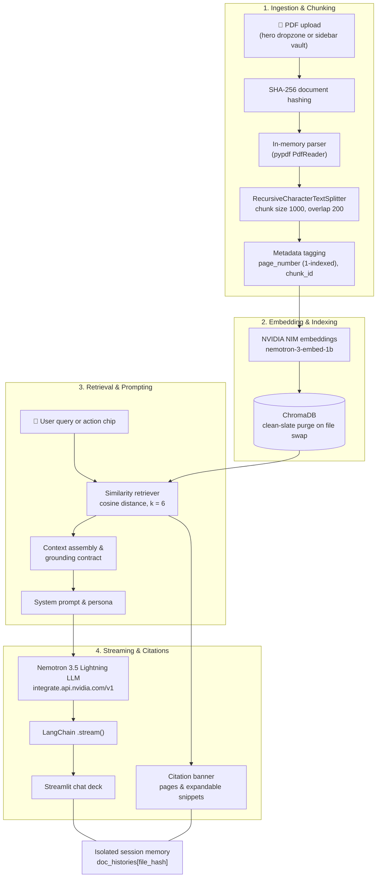

<div align="center">

# 📚 Study Buddy AI

### Autonomous Document Intelligence & Learning System

Ask questions about your PDFs and get **fast, page-cited, hallucination-resistant answers** — with every document kept in its own isolated context.

[](https://www.python.org/)
[](https://streamlit.io/)
[](https://build.nvidia.com/)
[](https://www.langchain.com/)
[](https://www.trychroma.com/)
[](LICENSE)
[](https://drive.google.com/YOUR_GOOGLE_DRIVE_LINK)

[Download](#-download) · [Features](#-key-features) · [Architecture](#-architecture) · [Quickstart](#-quickstart) · [Configuration](#-configuration) · [Project Structure](#-project-structure) · [Troubleshooting](#-troubleshooting--gotchas) · [Contributing](#-contributing)

</div>

---

## 📖 About

**Study Buddy AI** is a **Retrieval-Augmented Generation (RAG)** assistant for researchers, engineers, students and professionals. Upload a PDF — a paper, textbook, lecture slides, resume or technical manual — and interrogate it in natural language. Every answer is grounded in the document and comes with **page-level citations** you can verify.

Typical document Q&A tools suffer from three problems. Study Buddy AI addresses each one:

| Problem | How Study Buddy AI solves it |
|---|---|
| **Hallucinations & speculation** | A strict grounding contract: answers are based only on retrieved passages and cite `Page X, Chunk #Y`. |
| **Cross-document memory bleed** | Each file is identified by its SHA-256 hash. Indexing a new file purges the previous vector collection, and chat history is stored per document hash. |
| **High latency & clunky UI** | NVIDIA NIM streaming for a fast time-to-first-token, plus a dark glassmorphic "Ocean Breeze" Streamlit interface. |

---

## 📥 Download

Get the complete project as a ZIP file from Google Drive:

**[⬇️ Download Study Buddy AI (Google Drive)](https://drive.google.com/YOUR_GOOGLE_DRIVE_LINK)**

1. Open the link and click **Download**.
2. Extract the ZIP file.
3. Follow the [Quickstart](#-quickstart) to install dependencies and add your API keys.

> The download does not include `.env` or `.venv/`. Create your own `.env` from `.env.example`.

Prefer Git? Clone the repository instead:

```bash
git clone https://github.com/yash-sapavadiya-07/study-buddy-ai.git
```

---

## ✨ Key Features

| | Feature | Description |
|---|---|---|
| ⚡ | **Fast token streaming** | Responses stream token-by-token via NVIDIA NIM and LangChain. |
| 📑 | **Verified page citations** | Every answer includes a citation banner with 1-indexed page numbers and chunk IDs. |
| 🔍 | **Expandable context snippets** | Inspect the exact excerpts the model used. |
| 🔒 | **Zero-contamination isolation** | Automatic vector purging and hash-keyed chat history prevent cross-document leaks. |
| 🎯 | **Dual ingestion** | In-memory byte streams for UI uploads; disk paths for CLI workflows. |
| 💡 | **Quick action chips** | One-click document audit, weakness analysis, executive summary and 4-question quiz. |
| 🎨 | **Ocean Breeze UI** | Glassmorphism, animated gradients, floating sidebar toggle, unified chat input. |
| 🔄 | **Model fallback** | Falls back from NVIDIA NIM to Google Gemini when only a Gemini key is configured. |

---

## 🏗️ Architecture



### How it works

1. **Ingest & hash** — A PDF is dropped into the hero dropzone or sidebar uploader. A SHA-256 digest of the raw bytes gives it a unique identity.
2. **Parse in memory** — `pypdf` extracts text without disk I/O, skipping blank pages and rejecting documents with no extractable text.
3. **Chunk** — `RecursiveCharacterTextSplitter` splits text into 1,000-character chunks with 200 characters of overlap, preserving natural boundaries.
4. **Index in isolation** — When a new file arrives, the previous ChromaDB collection is purged (`clean_slate=True`), then the new chunks are embedded and stored.
5. **Retrieve** — Each question runs a similarity search over the current store and returns the top 6 passages with page metadata.
6. **Generate & stream** — The prompt and passages go to `nvidia/nemotron-3.5-lightning-30b-a3b`, which streams the answer alongside inspectable sources.

---

## 🛠️ Tech Stack

| Layer | Technology | Details |
|---|---|---|
| **LLM (primary)** | NVIDIA NIM | `nvidia/nemotron-3.5-lightning-30b-a3b` |
| **LLM (fallback)** | Google Gemini | `gemini-3.8-flash` |
| **Embeddings** | NVIDIA NIM | `nvidia/nemotron-3-embed-1b` (2048-dim) |
| **Vector DB** | ChromaDB | `chromadb >= 0.5.5`, disk-persisted, cosine distance |
| **Orchestration** | LangChain | `langchain >= 0.2.16`, `langchain-openai`, `langchain-google-genai` |
| **PDF parsing** | PyPDF | `pypdf >= 4.3.1` |
| **Frontend** | Streamlit | `streamlit >= 1.38.0` |
| **Typography** | Google Fonts | Outfit, Plus Jakarta Sans, JetBrains Mono |

---

## 📂 Project Structure

```text
study-buddy-ai/
├── app.py                # Streamlit app & Ocean Breeze UI
├── requirements.txt      # Python dependencies
├── .env.example          # Environment variable template
├── .gitignore
├── README.md
│
├── src/
│   ├── __init__.py
│   ├── pdf_loader.py     # PDF parsing, validation & chunking
│   ├── vector_store.py   # Embeddings & ChromaDB management
│   └── rag_pipeline.py   # Persona, grounding prompt & retrieval chain
│
└── chroma_db/            # Local vector store (auto-managed, git-ignored)
```

> **Never commit** `.env`, `chroma_db/` or `.venv/`. Keep them in `.gitignore`.

---

## ⚡ Quickstart

### Prerequisites

- **Python 3.10+** (tested on 3.10 – 3.13)
- An **NVIDIA NIM API key** from [build.nvidia.com](https://build.nvidia.com/) **or** a **Google Gemini API key** from [aistudio.google.com](https://aistudio.google.com/)

### 1. Clone and create a virtual environment

```bash
git clone https://github.com/yash-sapavadiya-07/study-buddy-ai.git
cd study-buddy-ai

python -m venv .venv
```

Activate it:

```bash
# Windows (PowerShell)
.\.venv\Scripts\Activate.ps1

# Linux / macOS
source .venv/bin/activate
```

### 2. Install dependencies

```bash
pip install --upgrade pip
pip install -r requirements.txt
```

### 3. Configure API keys

```bash
cp .env.example .env
```

Then edit `.env`:

```env
# Primary engine (NVIDIA NIM)
NVIDIA_API_KEY=nvapi-your_nvidia_nim_api_key_here

# Optional: Google Gemini fallback
GOOGLE_API_KEY=your_gemini_api_key_here

# ChromaDB
CHROMA_PERSIST_DIR=./chroma_db
COLLECTION_NAME=study_buddy_notes
```

### 4. Run

```bash
streamlit run app.py
```

Open **http://localhost:8501** in your browser, drop in a PDF, and start asking questions.

---

## ⚙️ Configuration

| Variable | Required | Default | Description |
|---|---|---|---|
| `NVIDIA_API_KEY` | Recommended | — | NVIDIA NIM key (`nvapi-...`). Enables the primary Nemotron engine. |
| `GOOGLE_API_KEY` | Optional | — | Gemini key. Used as a fallback when no NVIDIA key is set. |
| `GEMINI_API_KEY` | Optional | — | Alias for `GOOGLE_API_KEY`. |
| `CHROMA_PERSIST_DIR` | Optional | `./chroma_db` | Where vector indexes are stored. |
| `COLLECTION_NAME` | Optional | `study_buddy_notes` | Default ChromaDB collection name. |

---

## 🧩 Core Modules

<details>
<summary><b><code>src/pdf_loader.py</code></b> — PDF parsing & chunking</summary>

- `load_and_chunk_pdf_bytes(file_bytes, filename, ...)` — parses uploaded bytes in memory with `pypdf.PdfReader` and rejects empty or corrupt documents.
- `load_and_chunk_pdf(file_path, ...)` — disk-based loader using LangChain's `PyPDFLoader`.
- Converts 0-indexed PDF pages to **1-indexed** `page_number` values for readable citations.

</details>

<details>
<summary><b><code>src/vector_store.py</code></b> — embeddings & ChromaDB</summary>

- `get_embeddings_model(api_key)` — returns `OpenAIEmbeddings` pointed at NVIDIA NIM (with `check_embedding_ctx_length=False`), or falls back to `GoogleGenerativeAIEmbeddings`.
- `create_or_update_vector_store(chunks, clean_slate=True)` — rebuilds the index; with `clean_slate=True` the old store is purged first, guaranteeing no cross-document bleed.
- `load_vector_store(...)` — loads an existing on-disk index if valid.

</details>

<details>
<summary><b><code>src/rag_pipeline.py</code></b> — retrieval chain & persona</summary>

- `build_rag_chain(vector_store, k=6, api_key=None)` — a similarity retriever (top 6) chained to `create_stuff_documents_chain`.
- A system persona that sticks to document facts while still giving constructive critique for resume reviews and weakness audits.

</details>

<details>
<summary><b><code>app.py</code></b> — Streamlit interface</summary>

- **State isolation** — chat logs keyed by SHA-256 hash in `st.session_state.doc_histories`.
- **Floating sidebar toggle** — a fixed, glowing button (`div[data-testid="collapsedControl"]`) to reopen the vault.
- **Single chat dock** — CSS on `div[data-testid="stChatInput"] > div` removes double borders.
- **Live streaming** — `chain.stream({"input": query})` with a pulsing typing indicator.

</details>

---

## 🧠 Prompt Design

Study Buddy AI runs under a system instruction that balances factual accuracy with useful analysis:

```text
You are Study Buddy AI, an elite AI Document Analyst and Study Companion.
Your goal is to help users thoroughly understand, analyze, critique, and
extract knowledge from their uploaded documents (study notes, lecture slides,
resumes, papers, textbooks).

Guidelines:
1. Identity: When asked who you are, introduce yourself as Study Buddy AI.
2. Grounding & Accuracy: Base your factual answers, explanations, and quotes
   strictly on the provided Context excerpts.
3. Analysis & Critique: When the user asks for feedback, critique, evaluation,
   or weaknesses:
   - Thoroughly examine what is present versus what could be improved or missing.
   - Provide clear, constructive, professional, and actionable critique directly
     referencing the content.
4. Summaries & Synthesis: Provide structured, well-formatted answers with
   bullet points, bold headers, and key takeaways.
5. Out-of-Scope Questions: If the user asks about an entirely unrelated topic
   with zero connection to the document, politely let them know that the
   question is outside the scope of the provided materials.
```

---

## 🛡️ Troubleshooting & Gotchas

<details>
<summary><b>NVIDIA NIM returns <code>400 Invalid body: sequence expected string</code></b></summary>

`OpenAIEmbeddings` tokenizes text locally with `tiktoken` and sends integer lists, but NIM expects raw strings. Always disable the check:

```python
OpenAIEmbeddings(
    base_url="https://integrate.api.nvidia.com/v1",
    api_key=nvidia_key,
    model="nvidia/nemotron-3-embed-1b",
    check_embedding_ctx_length=False,  # Crucial for NVIDIA NIM
)
```

</details>

<details>
<summary><b>NVIDIA NIM returns <code>410 Gone</code></b></summary>

Legacy models such as `meta/llama-3.2-3b-instruct` have been retired from the NIM endpoint. This project uses the supported `nvidia/nemotron-3.5-lightning-30b-a3b`.

</details>

<details>
<summary><b>Streamlit chat input shows a double border</b></summary>

Style only the immediate child of the chat input container:

```css
div[data-testid="stChatInput"] > div {
    border: 1.5px solid rgba(0, 198, 255, 0.45) !important;
    border-radius: 18px !important;
    background: rgba(7, 16, 36, 0.85) !important;
}
```

</details>

---

## 🤝 Contributing

Contributions, bug reports and pull requests are welcome.

1. Fork the repository
2. Create a feature branch: `git checkout -b feature/AmazingFeature`
3. Commit your changes: `git commit -m "feat(scope): add AmazingFeature"`
4. Push the branch: `git push origin feature/AmazingFeature`
5. Open a Pull Request

Commits follow the `type(scope): description` convention (`feat`, `fix`, `docs`, `refactor`, `test`, `chore`). For the full development methodology, see [`PROJECT_RULES.md`](PROJECT_RULES.md) and [`GSD-STYLE.md`](GSD-STYLE.md).

---

## 📄 License

Distributed under the **MIT License**. See [`LICENSE`](LICENSE) for details.

---

<div align="center">
  <sub>Built by <a href="https://github.com/yash-sapavadiya-07">Yash Sapavadiya</a> · Powered by <strong>Study Buddy AI</strong></sub>
</div>
